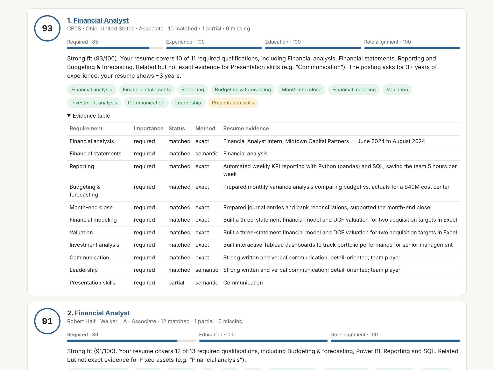

# JobFit — which entry-level jobs should I apply to?

JobFit is an API (plus a small web demo) that takes a student's resume and **ranks ~8,000 entry-level
Finance / Accounting / IT / Consulting / Analyst postings** by how well the resume covers each posting's
stated requirements. Every score is **transparent** (per-requirement evidence), **repeatable** (same input → same
score), and computed **at scale** (all 8,000 postings in well under a second on a laptop CPU).

> The score measures *requirement coverage*, not the probability of getting an interview.



## How it works

```
                 ┌───────────── offline, once ─────────────┐
LinkedIn JDs ──► structured extraction ──► requirement + title embeddings ──► job index (8,000)
 (Kaggle)        (LLM w/ fixed JSON schema                                     data/processed/index
                  or rule-based fallback)
                                                                                     │
resume (PDF/DOCX/TXT) ──► structured extraction ──► evidence units + embeddings ─────┤
                                                                                     ▼
                         per-requirement matching (exact skill ▸ semantic evidence) ──► transparent score
                         ──► ranking (vectorised over all postings) ──► explanation (LLM or template)
```

1. **Structured extraction.** Each JD becomes a list of requirements (`text`, `category`, `required|preferred`,
   canonical `skill`), minimum years and minimum education. Two interchangeable back-ends produce the same schema:
   an LLM (Gemini via its OpenAI-compatible API, temperature 0, fixed JSON schema, SQLite-cached) and a deterministic
   rule-based extractor (115-skill taxonomy + section heuristics: *Requirements / Preferred / Responsibilities*).
2. **Semantic matching.** Each requirement is linked to the closest resume evidence. An exact taxonomy hit counts
   fully; otherwise sentence embeddings (all-MiniLM-L6-v2, ONNX) give partial credit, so *"built Tableau dashboards"*
   supports *"Power BI"*. Requirements are embedded with a short descriptor (e.g. *"Power BI (business intelligence
   dashboards…)"*), which raised positive-vs-negative AUC from 0.920 → 0.947. Thresholds are calibrated from data
   (`scripts/calibrate.py`).
3. **Scoring & ranking.** An explicit formula (see `app/scoring.py`):
   `overall = 100 · Σ W_c·sub_c / Σ W_c` over the defined sub-scores *required coverage (0.45), preferred
   coverage (0.10), experience (0.15), education (0.10), role alignment (0.20)*. Coverage is a weighted, smoothed
   average of per-requirement strengths (required ×1, preferred ×0.5, soft skills ×0.5). The same formula is
   implemented per-pair (with evidence) and vectorised over the whole index; a test checks they agree.
4. **Explanations** are generated only from the structured match output — by an LLM when a key is configured,
   otherwise by a deterministic template.

## Quick start (Docker)

```bash
docker compose up --build          # builds the image, downloads the embedding model, serves on :8000
```
or
```bash
docker build -t jobfit-api .
docker run -p 8000:8000 jobfit-api
# optional LLM features:
docker run -p 8000:8000 -e GEMINI_API_KEY=your_key jobfit-api
```

Open **http://localhost:8000** for the demo, **http://localhost:8000/docs** for interactive API docs.
The container works fully offline without an API key (rule-based extraction + template explanations).

## API

| Method | Path | Description |
|---|---|---|
| GET  | `/health` | service, index and model info |
| POST | `/rank` | rank all postings for a resume — filters: `levels`, `functions`, `remote_only`, `location_contains` |
| POST | `/rank/upload` | same, resume uploaded as PDF / DOCX / TXT (multipart) |
| POST | `/match` | one resume vs one job description, with per-requirement evidence |
| POST | `/jobs/{job_id}/match` | score a resume against a stored posting |
| GET  | `/jobs/{job_id}` | posting metadata, extracted profile, full description |
| POST | `/extract/jd`, `/extract/resume` | structured extraction only |

```bash
curl -X POST localhost:8000/rank -H 'Content-Type: application/json' \
  -d '{"resume_text": "...", "top_k": 5, "levels": ["Internship"], "functions": ["FIN","ACCT"]}'

curl -X POST localhost:8000/rank/upload -F file=@my_resume.pdf -F top_k=10

curl -X POST localhost:8000/match -H 'Content-Type: application/json' \
  -d '{"resume_text": "...", "job_description": "...", "job_title": "Staff Accountant"}'
```

Response (abridged):
```json
{"total_postings_scored": 8000, "elapsed_ms": 380.2,
 "results": [{"title": "Financial Analyst", "company": "CBTS", "score": 93.0,
   "subscores": {"required": 0.85, "preferred": null, "experience": 1.0, "education": 1.0, "role": 1.0},
   "matched": 10, "partial": 1, "missing": 0,
   "requirements": [{"requirement": "Financial modeling", "importance": "required", "status": "matched",
                     "method": "exact", "strength": 1.0,
                     "evidence": "Built a three-statement financial model and DCF valuation ..."}],
   "explanation": "Strong fit (93/100). Your resume covers 10 of 11 required qualifications ..."}]}
```

## Data

| Dataset | Use | After filtering |
|---|---|---|
| [Kaggle Resume Dataset](https://www.kaggle.com/datasets/snehaanbhawal/resume-dataset) (2,484 resumes, 24 categories) | evaluation | 586 resumes in FINANCE, BANKING, ACCOUNTANT, INFORMATION-TECHNOLOGY, CONSULTANT |
| [LinkedIn Job Postings 2023–24](https://www.kaggle.com/datasets/arshkon/linkedin-job-postings) (123,849 postings) | job database | 47,983 Entry/Associate/Internship → 12,065 in FIN/ACCT/IT/CNSL/ANLS → 8,000 sampled (all non-IT-only + IT-only fill, seed 42) |

The processed database and index are committed (`data/processed`, ~18 MB), so the API runs without Kaggle access.
To rebuild from scratch:

```bash
pip install -r requirements-dev.txt
bash scripts/download_data.sh                 # Kaggle -> data/raw
python scripts/prepare_data.py                # filter + sample -> data/processed/*.jsonl.gz
python scripts/build_index.py                 # rule-based extraction (~1 min on 4 cores)
GEMINI_API_KEY=... python scripts/build_index.py --extractor llm   # LLM extraction (cached)
python scripts/calibrate.py                   # similarity thresholds -> eval/calibration.json
```

## Evaluation

```bash
python eval/evaluate.py                       # ranking, paraphrase, counterfactual, stability -> eval/results/
python eval/make_figures.py                   # docs/figures/*.png
GEMINI_API_KEY=... python eval/llm_baseline.py   # plain-LLM baseline (variance, latency, agreement)
pytest -q                                     # 26 unit + integration tests
```

See `docs/JobFit_Final_Report` for results and discussion.

## Configuration (environment variables)

| Variable | Default | Meaning |
|---|---|---|
| `GEMINI_API_KEY` / `LLM_API_KEY` | – | enables LLM extraction & explanations |
| `LLM_BASE_URL` | Gemini OpenAI-compatible endpoint | any OpenAI-compatible server (OpenAI, vLLM, Ollama) |
| `LLM_MODEL` | `gemini-2.5-flash-lite` | model name |
| `JOBFIT_EXTRACTOR` / `JOBFIT_EXPLAINER` | `auto` | `llm`, `rule`/`template`, or `auto` (LLM if key present) |
| `JOBFIT_EMBED_MODEL` | `sentence-transformers/all-MiniLM-L6-v2` | any fastembed model |
| `JOBFIT_SIM_LO` / `JOBFIT_SIM_HI` | 0.32 / 0.52 | calibrated semantic ramp |

## Repository layout

```
app/            FastAPI service: extraction, embeddings, scoring, explanations, web demo (static/)
scripts/        data download / preparation, index build, calibration, model download
eval/           evaluation scripts, paraphrase benchmark, results/*.json
tests/          pytest suite (unit + API integration)
data/processed/ 8,000 postings, 586 evaluation resumes, pre-built index
docs/           final report, slides, figures
```
